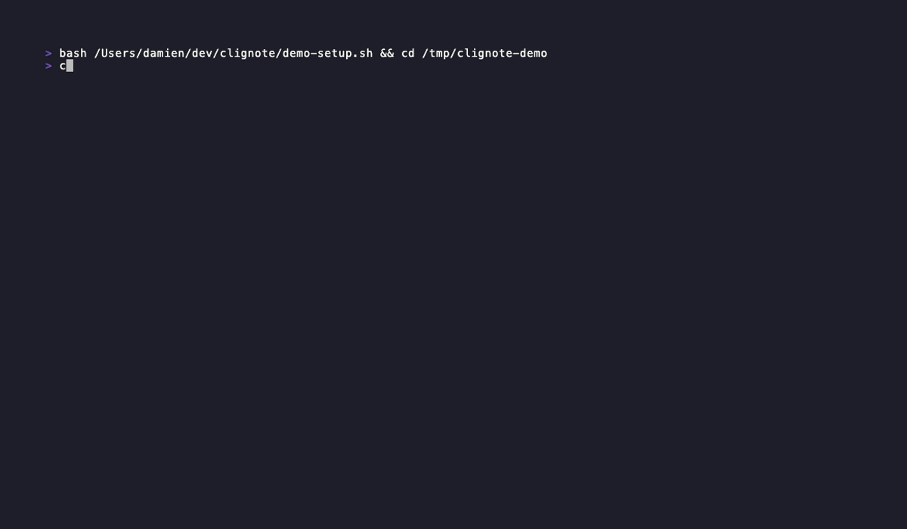

#+title: clignote

* Clignote

A terminal-first text editor for org-mode files, with evil-mode (vim) keybindings.

~cln~ is the CLI entry point.

** goals

- fast, distraction-free editing of org-mode files in the terminal
- vim motions / keybindings (evil-mode style) as first-class citizens
- correct parsing and rendering of org-mode syntax
- future: native macOS desktop app
- future: mobile app (Android / iOS)

** status

early development — usable for basic editing and journaling, but expect rough edges

** installation

*** from source

Requires [[https://rustup.rs/][Rust]] 1.75 or later.

#+begin_src sh
git clone https://github.com/damien/clignote
cd clignote
cargo install --path crates/cln
#+end_src

This installs =cln= to =~/.cargo/bin=, which is on your =PATH= if you followed the standard Rust installation.

*** cargo

#+begin_src sh
cargo install clignote
#+end_src

(not yet published to crates.io)

** usage

#+begin_src sh
cln file.org          # open a file
cln                   # start with an empty buffer
cln dir/              # browse a directory
#+end_src

*** keybindings (evil-mode)

| key       | action                        |
|-----------+-------------------------------|
| ~h j k l~ | move left / down / up / right |
| ~w b~     | word motions                  |
| ~C-d C-u~ | half-page down / up           |
| ~/~ ~n N~ | incremental search, next / prev match |
| ~0 $~     | line start / end              |
| ~gg G~    | file start / end              |
| ~i a o O~ | enter insert mode             |
| ~<Esc>~   | return to normal mode         |
| ~x~       | delete character              |
| ~dd dw~   | delete line / word            |
| ~dt{char}~ | delete up to a character     |
| ~v V~     | visual / visual-line mode (~d x y~) |
| ~yy~      | yank line                     |
| ~p P~     | paste after / before          |
| ~u~       | undo                          |
| ~C-r~     | redo                          |
| ~Tab~     | fold heading (cycle)          |
| ~S-Tab~   | fold all (cycle)              |
| ~M-h M-l~ | promote / demote heading (~SPC m h/l~) |
| ~M-H M-L~ | promote / demote subtree (~SPC m H/L~) |
| ~M-j M-k~ | move subtree down / up (~SPC m j/k~)   |
| ~S-← S-→~ | cycle TODO keyword (~SPC m t/T~)       |
| ~RET~     | in insert mode: continue list item     |
| ~SPC t w~ | toggle soft wrap (on by default)       |
| ~SPC t i~ | toggle body indent under headings (on by default) |
| ~SPC t n~ | cycle line numbers: off, absolute, relative |
| ~SPC f f~ / ~SPC SPC~ | fuzzy file picker (~Tab~ completes) |
| ~SPC f s~ / ~SPC f S~ | save / save, commit and push |
| ~SPC b b n p d~ | buffer list / next / prev / kill |
| ~C-w s v w q hjkl~ | split, cycle, close, focus panes (also ~SPC w …~) |
| ~SPC t l~ | toggle link display (label / target) |
| ~SPC j j~ | journal: new entry today (also ~SPC n j j~) |
| ~SPC j t~ | journal: open today, no new entry |
| ~SPC j n / p~, ~C-n / C-p~ | journal: next / previous day |
| ~SPC q q~ | quit                          |
| ~:w~      | save                          |
| ~:q~      | quit                          |
| ~:wq~     | save and quit                 |
| ~:e file~ | open a file (~:e!~ discards changes) |
| ~:sp :vs~ | horizontal / vertical split   |
| ~:Ex [dir]~ | directory browser           |

** configuration

=$XDG_CONFIG_HOME/clignote/config.toml= (default =~/.config/clignote/config.toml=). Unknown keys are reported as errors.

#+begin_src toml
[journal]
dir = "~/org/journal"      # default ~/org/journal; $CLN_JOURNAL_DIR overrides
file_format = "%Y%m%d"     # ".org" is appended
entry_level = 1            # heading level of a timed entry (1-6)
blank_line_above = true    # blank line before a new entry
blank_line_below = false   # blank line between entry heading and text

[editor]
line_numbers = "relative"  # "off", "absolute" or "relative"
#+end_src

** org-mode support

| feature               | status  |
|-----------------------+---------|
| headings (~* ** ...~) | parsed, highlighted, foldable, restructurable |
| TODO keywords         | parsed, highlighted, cycling |
| priorities, tags      | parsed, highlighted |
| bold / italic / code  | parsed, highlighted |
| links                 | parsed, rendered, openable with ~RET~ |
| lists, drawers, src blocks, timestamps | parsed (lossless) |
| journal (org-journal style) | daily files |
| tables, checkboxes    | planned |
| agenda                | future  |
| babel / src blocks    | future  |
